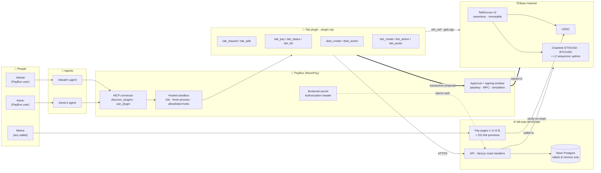
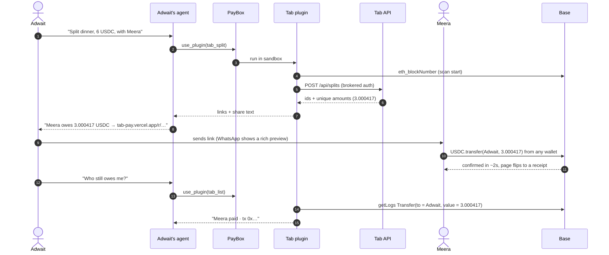
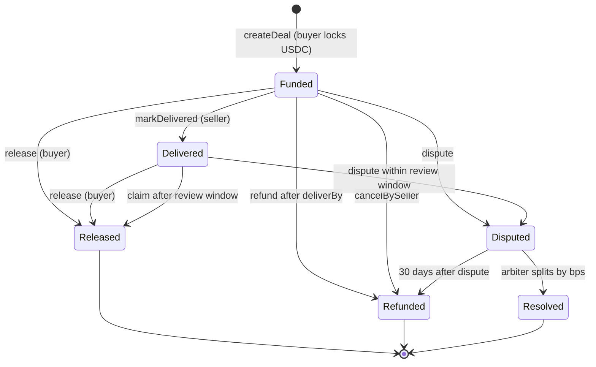
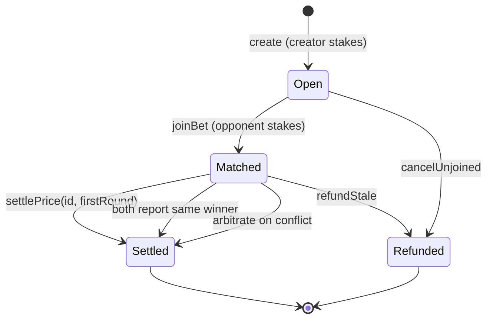

<div align="center">

# Tab

### Multiplayer money for AI agents

Split bills, request USDC, lock escrowed deals and settle friendly bets between people, straight from your agent

[](https://tab-pay.vercel.app)
[](https://basescan.org/address/0xCe8dE8f1647ED91Db4Ba9B71B9AF94e2405cbCe9)
[](https://basescan.org/address/0xCe8dE8f1647ED91Db4Ba9B71B9AF94e2405cbCe9#code)
[](https://repo.sourcify.dev/contracts/full_match/8453/0xCe8dE8f1647ED91Db4Ba9B71B9AF94e2405cbCe9/)
[](contracts/SECURITY.md)
[](https://developer.paybox.sh)

**A PayBox plugin for MoonPay Hackathons, Chapter 1**

</div>

---

## The idea in one breath

PayBox gave agents a wallet. **Tab gives them each other.**

Every plugin in the PayBox marketplace today is single player: *my* agent, *my* wallet, *my* trade. But the money people move most often goes **between people**: who owes what for dinner, paying the freelancer when the work lands, the bet you made with a friend on Sunday's match. Tab turns those moments into one sentence to your agent, settled on Base, with a receipt nobody can argue with.

> **"Split dinner, 6 USDC, with Meera and Aarav"**
> Tab creates two links. Meera pays from her phone in two taps. Aarav's agent pays his. You ask "who still owes me?" and Tab answers from the chain itself.

<table>
<tr>
<td width="25%" valign="top">

**💸 Split & request**

Shareable pay links with exact on-chain matching. No database to trust

</td>
<td width="25%" valign="top">

**🤝 Escrowed deals**

Pay on delivery. Funds sit in an ownerless contract, and every lock has a way out

</td>
<td width="25%" valign="top">

**🎲 Friendly bets**

Both stakes locked. Chainlink settles price bets with an on-chain proof

</td>
<td width="25%" valign="top">

**🔗 Viral pay pages**

Any wallet can pay. Every link invites someone new into PayBox

</td>
</tr>
</table>

---

## Architecture



### Trust model: the chain is the receipt

| Layer | Holds | Trusted for | If it lies or dies |
|---|---|---|---|
| **Base** (USDC, TabEscrow, Chainlink) | Money and outcomes | Everything that matters | n/a, this is the ground truth |
| **Tab API + Postgres** | Labels, memos, split grouping | Nothing money-critical | Plugin and pages re-verify on-chain. Links still work offline via self-contained payloads |
| **Tab plugin** | Nothing, it's stateless | Building correct proposals | PayBox simulates every proposal and the user approves it with a passkey |
| **PayBox** | Keys (MPC), policy, approvals | Signing only what the user approves | Never sees the plugin's API key in code, never lets the plugin pick a wallet |

---

## How a split settles



**Why the odd amount?** Each request gets a unique suffix below one cent (`3.000417`). That makes every payment matchable from public Transfer logs alone, with no custom contract, no allowance and no trusted server. One plain USDC transfer is the cheapest possible way to pay, and it's also the proof.

---

## Escrow state machines

<table>
<tr>
<td width="50%" valign="top">

**Deals**



</td>
<td width="50%" valign="top">

**Bets**



</td>
</tr>
</table>

**Liveness guarantee:** every dollar locked in TabEscrow has an exit that doesn't need the other side's cooperation. Every path above was exercised in tests, with 100% branch coverage.

---

## Innovations

### 1. First-round oracle proof
Naive price bets settle at whatever the price is when someone presses settle, so the winning side just waits for a good moment. Tab's `settlePrice(id, roundId)` only accepts **the first Chainlink round at or after the deadline**:

```
require round.updatedAt  >= resolveAt          // late enough
require prevRound.updatedAt < resolveAt        // and it's the FIRST such round
require phase(roundId) == feed.phaseId()       // no cherry-picking across aggregator upgrades
require sequencer up for > 1h                  // L2 safety
require round.updatedAt <= resolveAt + 1h      // fresh enough to represent the deadline
```

The outcome is the same no matter who settles or when. A tiny TypeScript helper (`shared/findSettlementRound.ts`) walks the feed back to find that round for you.

### 2. Stateless payment matching
The plugin sandbox keeps no memory between calls, and Tab doesn't need any. Unique sub-cent amounts plus `eth_getLogs` give **database-free payment verification**. If the API is down, `tab_request` still returns a self-contained, checksummed link (`/r/p.<payload>`).

### 3. Proposals that explain themselves
PayBox's approval window shows network, sender and raw transaction details, and doesn't decode ERC-20 calls. So every Tab proposal ships with plain words: *"Transfer exactly 3.000417 USDC on Base to 0xbEfF…3d2E. No allowance is granted."* Joining a bet spells out your side, the exact winning condition, the deadline in UTC and IST, and **warns you if the other side picked the arbiter**.

### 4. Every lock has a way out
Deadlines, review windows, join windows and stale-oracle refunds mean nobody can hold money hostage by going silent. Disputes only open inside the review window, so a buyer can't take the work and then refund themselves.

### 5. Blacklist-proof payouts
USDC can blacklist addresses. If one party is blacklisted, a naive contract freezes both sides. TabEscrow tries a direct transfer and, if that fails, credits `owed[to]` for a later `withdraw()`, so the honest side always gets paid.

### 6. A growth loop built into the product
Every Tab link is an invitation. People without PayBox pay from any wallet, see a polished receipt, and get one line: *let your agent handle this next time*. Every split brings new people into PayBox.

### 7. Exact amounts everywhere
Request payments are plain transfers, so they grant no allowance. Escrow approvals are for the exact amount, never unlimited. The plugin never asks for a key and never chooses a wallet.

---

## Security

Put through a dedicated security review before launch. Every finding was fixed in v2 or mitigated in the plugin, and each is tracked in [`contracts/SECURITY.md`](contracts/SECURITY.md).

| Threat | Defense |
|---|---|
| Reentrancy, accounting drift | CEI + `nonReentrant`, SafeERC20, invariant: `balance == locked + Σ owed` |
| Oracle timing games | First-round proof, phase pinning, staleness + sequencer checks |
| Free option on late joins | `MIN_JOIN_GAP` = 10 min enforced on-chain, stricter in the plugin |
| Rigged arbiter | Joiner sees an explicit warning naming the arbiter |
| Spoofed or tampered links | API cross-check, checksummed payloads, labels marked unverified |
| SSRF via pasted links | Only the id is extracted. The host is fixed to the configured API |
| Prompt injection via memos | Control, bidi and zero-width characters stripped, length-capped, quoted as user text |
| Key leakage | API key is a PayBox brokered header, never in the bundle or logs |

---

## Deployed

| | Address |
|---|---|
| **TabEscrow v2** | [`0xCe8dE8f1647ED91Db4Ba9B71B9AF94e2405cbCe9`](https://basescan.org/address/0xCe8dE8f1647ED91Db4Ba9B71B9AF94e2405cbCe9) |
| USDC | `0x833589fCD6eDb6E08f4c7C32D4f71b54bdA02913` |
| Chainlink ETH/USD | `0x71041dddad3595F9CEd3DcCFBe3D1F4b0a16Bb70` |
| Chainlink BTC/USD | `0x64c911996D3c6aC71f9b455B1E8E7266BcbD848F` |
| L2 sequencer uptime | `0xBCF85224fc0756B9Fa45aA7892530B47e10b6433` |

## Plugin tools

| Tool | What it does | Wallet action |
|---|---|---|
| `tab_request` | Create a pay link | none |
| `tab_split` | Split a total, exact rounding | none |
| `tab_pay` | Pay a link | USDC transfer |
| `tab_status` | On-chain status of any request, split, deal or bet | none |
| `tab_list` | Who owes you, what you owe, open deals and bets | none |
| `deal_create` | Lock funds for a job | exact approve, then create |
| `deal_action` | Deliver, release, claim, refund, dispute, resolve, withdraw | contract call |
| `bet_create` | Price or event bet with live preview | exact approve, then create |
| `bet_action` | Join, settle, report, arbitrate, cancel, refund, withdraw | contract call |
| `tab_quote` | Live Chainlink price | none |

## Built with

Solidity 0.8.28 · Foundry · OpenZeppelin 5 · TypeScript · MCP server SDK 2.0 · zod 4 · viem · Next.js · Tailwind · wagmi · Neon Postgres · Drizzle · Vercel · Chainlink · Base

## Repo

```
contracts/   TabEscrow, 124 tests (unit · fuzz · invariant · mainnet fork), deploy script
plugin/      PayBox plugin on the official starter, dist/plugin.mjs is the upload
web/         Pay pages, API, OG images, escrow indexer
shared/      ABI, API contract, settlement-round helper
docs/PRD.md  Full product spec
```

<div align="center">

**Built by Adwait for MoonPay Hackathons**

*Agents finally have each other*

</div>
